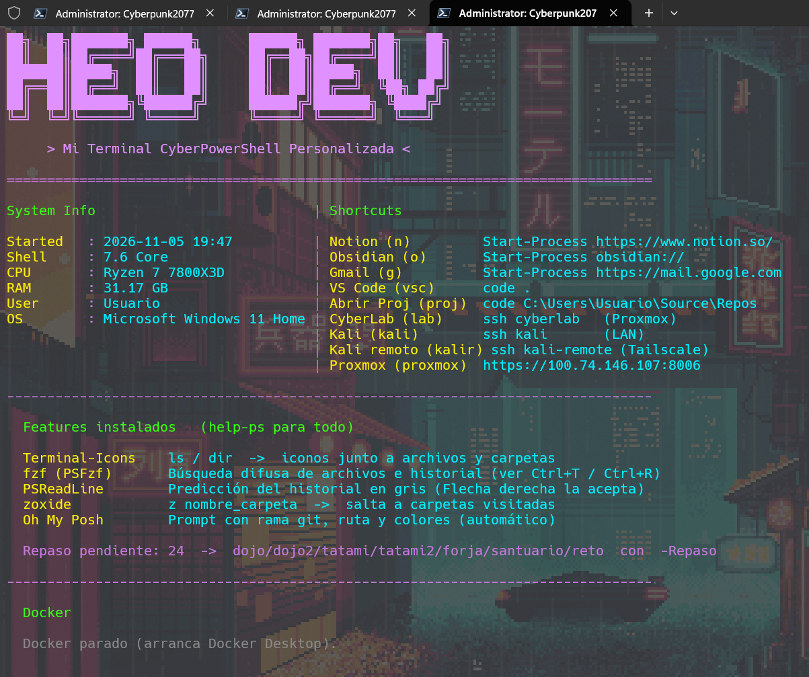
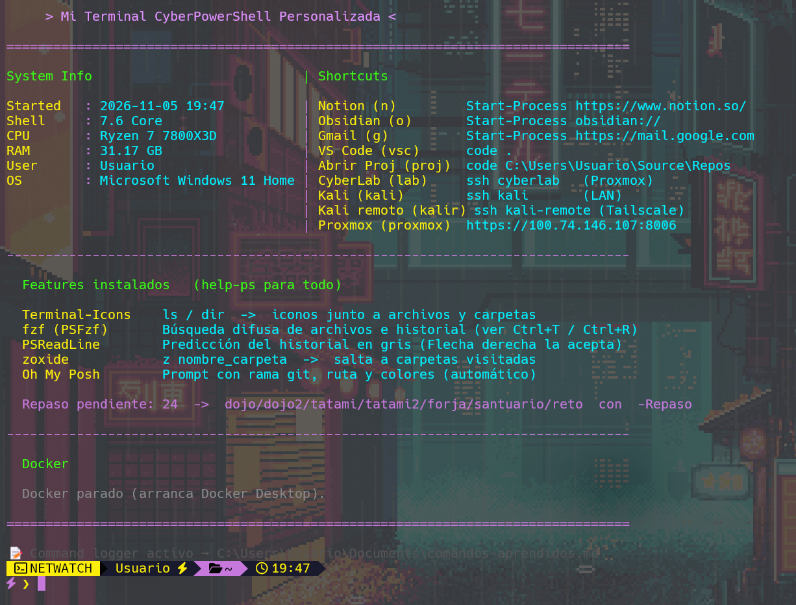
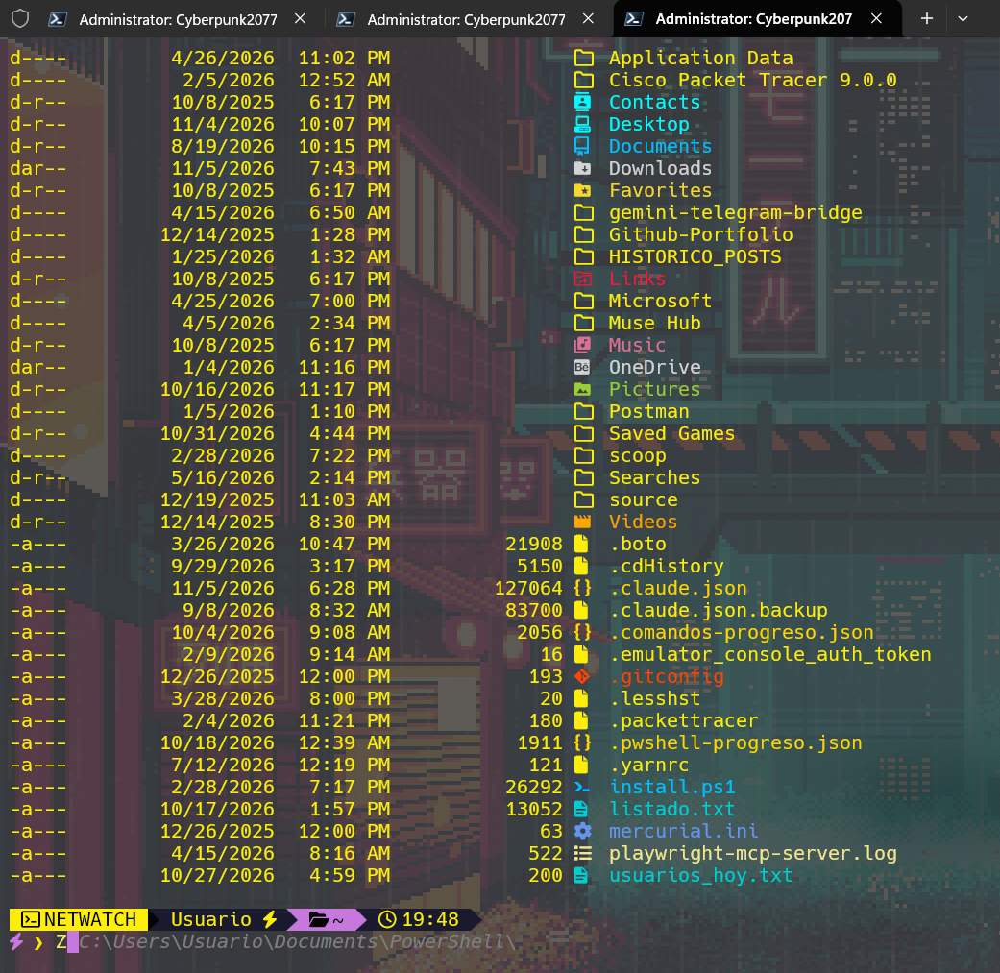
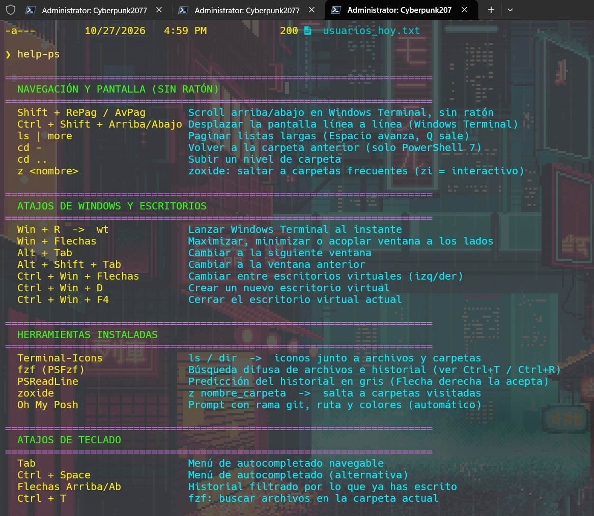
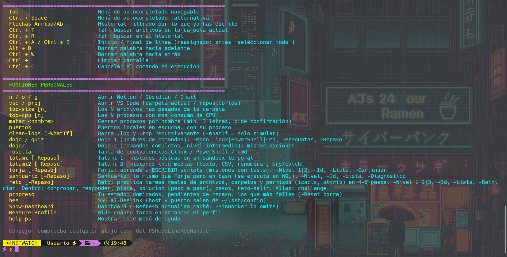

<div align="center">

<pre>
 ██╗  ██╗███████╗ ██████╗    ██████╗ ███████╗██╗   ██╗
 ██║  ██║██╔════╝██╔═══██╗   ██╔══██╗██╔════╝██║   ██║
 ███████║█████╗  ██║   ██║   ██║  ██║█████╗  ██║   ██║
 ██╔══██║██╔══╝  ██║   ██║   ██║  ██║██╔══╝  ╚██╗ ██╔╝
 ██║  ██║███████╗╚██████╔╝   ██████╔╝███████╗ ╚████╔╝
 ╚═╝  ╚═╝╚══════╝ ╚═════╝    ╚═════╝ ╚══════╝  ╚═══╝
</pre>

**my-Heo-Terminal — Mi terminal personal Cyberpunk 2077**

</div>

> **Repo privado.** La versión pública (sin mis atajos ni los módulos de cursos) está en [powershell-cyberpunk](https://github.com/HEO-80/powershell-cyberpunk).

---

## ⚡ Quick Install

Abre PowerShell y ejecuta en orden:

```powershell
# 1. Instalar Git (saltar si ya lo tienes)
winget install Git.Git -s winget --accept-package-agreements --accept-source-agreements

# 2. Instalar la terminal (tema + training + herramientas)
irm https://raw.githubusercontent.com/HEO-80/my-Heo-Terminal/main/install.ps1 | iex

# 3. Reiniciar PowerShell, luego instalar extras (opcional)
irm https://raw.githubusercontent.com/HEO-80/my-Heo-Terminal/main/extras/FileTools.ps1 | iex
irm https://raw.githubusercontent.com/HEO-80/my-Heo-Terminal/main/extras/PSRemoting.ps1 | iex
irm https://raw.githubusercontent.com/HEO-80/my-Heo-Terminal/main/extras/EventMonitor.ps1 | iex
irm https://raw.githubusercontent.com/HEO-80/my-Heo-Terminal/main/extras/Install-AI.ps1 | iex
irm https://raw.githubusercontent.com/HEO-80/my-Heo-Terminal/main/extras/Install-DragDrop.ps1 | iex
```

> Requiere acceso al repo (privado). Si da error en el paso 2, clona manualmente con `git clone` usando tu token.
>
> Si winget no funciona (ej. usuario Admin sin Microsoft Store), instala Git desde [git-scm.com](https://git-scm.com/download/win) y salta el paso 1.

---

## Screenshots

### Dashboard con mis atajos, SSH y CyberLab



### Dashboard completo con Docker y repaso pendiente



### Terminal-Icons — iconos para archivos y carpetas



### help-ps — todos los comandos, atajos y herramientas




---

## Qué incluye

### 🎨 Tema Cyberpunk 2077
- Prompt NETWATCH con rama git, ruta y tiempo de ejecución (Oh My Posh)
- Dashboard al arrancar: sistema, atajos, Docker, repaso pendiente
- Paleta ANSI true-color personalizable (`$global:CY`)

### 🔧 Mis atajos personales

| Comando | Qué hace |
|---|---|
| `n` / `o` / `g` | Notion / Obsidian / Gmail |
| `vsc` / `proj` | VS Code (carpeta actual / mis repos) |
| `bee` / `lab` / `kali` / `kalir` | SSH: Beelink / CyberLab / Kali LAN / Kali Tailscale |
| `proxmox` / `proxlocal` | Abrir Proxmox (Tailscale / LAN) |
| `workspaces` | Abrir todos los perfiles de Chrome |
| `setup` | Mi setup completo: Chrome + Kali + Proxmox |
| `chrome-dev` / `chrome-docencia` / `chrome-study` / `chrome-ocio` | Perfiles individuales |

### 🛠 Funciones ergonómicas

| Comando | Qué hace |
|---|---|
| `top-size [n]` | Los N archivos más pesados de la carpeta |
| `top-cpu [n]` | Los N procesos con más CPU |
| `matar <nombre\|pid>` | Cerrar procesos por nombre o PID (con confirmación) |
| `puertos` | Puertos en escucha con nombre del proceso |
| `clean-logs [-WhatIf]` | Borrar .log y .tmp recursivamente |
| `Measure-Profile` | Medir cuánto tarda en arrancar el perfil |

### 💻 Herramientas de desarrollo (Dev.ps1)

| Comando | Qué hace |
|---|---|
| `dev` | Estado de un vistazo: rama git, herramientas, BD Docker, puertos |
| `entorno` | Versiones de Java, .NET, Node, Python, Docker... |
| `jr <Clase>` | Compilar y ejecutar Java (javac + java) |
| `javas` / `usa-java 17` | Ver JDKs instalados / cambiar de JDK |
| `gst` / `glog` / `gdif` / `gac` / `gsync` | Git rápido con protección de secretos |
| `procesos` / `hijos` / `arbol` | Procesos, hijos de un PID, árbol |
| `lanzar prog args` | ProcessBuilder de PowerShell (PID, stdout, stderr, tiempo) |
| `mide { } [-Veces n]` | Medir cuánto tarda un bloque |
| `proceso-vs-hilo` | Demostrar Start-Job (proceso) vs Start-ThreadJob (hilo) |
| `db-up mysql` | BD en Docker: mysql, postgres, mongo, sqlserver, redis |
| `api <url>` | Llamada HTTP con estado, tiempo y JSON formateado |
| `servidor` | Servidor web estático para HTML/CSS/JS |
| `nuevo java\|web\|node\|dotnet <nombre>` | Proyecto nuevo con git init |
| `secretos` | Buscar contraseñas y claves en el código |
| `cargar-env` | Cargar variables de un .env |
| `limpia [-WhatIf]` | Borrar node_modules, target, bin/obj, __pycache__... |
| `grepr <texto>` | Buscar texto en código (sin node_modules ni .git) |

### 🥋 Sistema de entrenamiento completo

Sistema Leitner de repetición espaciada — lo que fallas vuelve antes, lo que dominas aparece menos.

| Módulo | Comando | Qué practicas |
|---|---|---|
| **Dojo 1** | `dojo` | Nombres de comandos: Linux vs PowerShell vs CMD |
| **Dojo 2** | `dojo2` | Comandos completos con argumentos |
| **Rosetta** | `rosetta` | Tabla de equivalencias Linux / PowerShell / CMD |
| **Tatami 1** | `tatami` | Misiones prácticas en sandbox (básico) |
| **Tatami 2** | `tatami2` | Misiones intermedias: texto, CSV, renombrar |
| **Forja** | `forja` | Escribir scripts PowerShell con tests |
| **Santuario** | `santuario` | Escribir scripts bash (WSL) |
| **Reto** | `reto` | Archivos, carpetas y permisos (icacls, attrib) |
| **PwShell2** | `pwshell2` | Scripting avanzado: variables, funciones, JSON, servicios |
| **Comandos** | `comandos` | CMD y scripts .bat |
| **Terraform** | `terraform-dojo` | init, plan, apply, state, modules, import |
| **AWS CLI** | `awscli` | S3, EC2, IAM, VPC, Lambda, CloudWatch |
| **Azure CLI** | `azcli` | VMs, App Service, AKS, Storage, IAM, Monitor |
| **Ansible** | `ansible-dojo` | ad-hoc, playbooks, roles, vault, galaxy |
| **Progreso** | `progreso` | Stats: dominados, pendientes, más fallados |

---

## Extras (add-ons opcionales)

Scripts independientes que puedes instalar por separado.

### 🤖 Install-AI — Instalador de asistentes IA

```powershell
irm https://raw.githubusercontent.com/HEO-80/my-Heo-Terminal/main/extras/Install-AI.ps1 | iex
```

Menú interactivo para instalar Opencode (Gemini), Claude Code o GitHub Copilot CLI con configuración de API keys.

### 📁 FileTools — Funciones para archivos

```powershell
irm https://raw.githubusercontent.com/HEO-80/my-Heo-Terminal/main/extras/FileTools.ps1 | iex
```

| Comando | Qué hace |
|---|---|
| `info <ruta>` | Info completa de archivo o carpeta |
| `hash <ruta>` | Hash SHA-256 (o MD5/SHA1/SHA512) |
| `peso [ruta]` | Qué subcarpetas ocupan más |
| `buscar <texto>` | Encontrar archivos por nombre |
| `duplicados` | Encontrar duplicados por hash |
| `renombrar` | Renombrar en lote (`-WhatIf` para previsualizar) |
| `comparar <A> <B>` | Comparar dos carpetas |

### 🖥 PSRemoting — Administración remota

```powershell
irm https://raw.githubusercontent.com/HEO-80/my-Heo-Terminal/main/extras/PSRemoting.ps1 | iex
```

| Comando | Qué hace |
|---|---|
| `maquinas` | Listar / agregar / quitar máquinas guardadas |
| `ping-remoto <equipos>` | Comprobar estado (ping + WinRM) |
| `remoto <equipos> { cmd }` | Ejecutar comando en varias máquinas en paralelo |
| `ir <equipo>` | Sesión interactiva (como SSH) |
| `disco-remoto <equipos>` | Espacio en disco en remoto |
| `servicios-remoto <eq> svc1,svc2` | Estado de servicios en remoto |
| `reiniciar-servicio <eq> svc` | Reiniciar servicio en remoto |
| `info-remoto <equipos>` | Info del sistema: SO, CPU, RAM, uptime, IP |
| `copiar-remoto -A <eq> ...` | Copiar archivos a/desde máquinas remotas |
| `activar-winrm` | Activar WinRM local y configurar TrustedHosts |

> Usa `todas` para lanzar a todas las guardadas. Usa `-Credencial` para pedir usuario/pass.

### 📊 EventMonitor — Monitor de eventos

```powershell
irm https://raw.githubusercontent.com/HEO-80/my-Heo-Terminal/main/extras/EventMonitor.ps1 | iex
```

| Comando | Qué hace |
|---|---|
| `vigilar [-Horas 24]` | Resumen completo: errores, logins fallidos, servicios caídos, reinicios |
| `logins [-Solo Fallidos]` | Intentos de login con usuario, IP y método |
| `errores [-Log System]` | Errores críticos de cualquier log |
| `buscar-evento <ID>` | Buscar por Event ID o `-Texto` en el mensaje |
| `exportar-eventos` | Exportar errores a CSV en el escritorio |
| `ids` | Referencia rápida de Event IDs importantes |

> Ejecutar como Admin para leer Security. Combinar con PSRemoting: `remoto Servidor01 { vigilar -Horas 4 }`

### 🖱 Install-DragDrop — Integración con Explorer

```powershell
irm https://raw.githubusercontent.com/HEO-80/my-Heo-Terminal/main/extras/Install-DragDrop.ps1 | iex
```

Tres formas de analizar archivos al instante:

1. **Arrastrar** — arrastra archivos encima de `CyberAnalizar.bat` en el Escritorio
2. **Clic derecho** — "Analizar con CyberTools" en el menú de Explorer (necesita Admin)
3. **Terminal** — `recibir archivo1.pdf archivo2.docx`

> Usa las funciones de FileTools (info + hash). Desinstalar: `Uninstall-CyberToolsMenu` como Admin.

---

## Estructura

```
my-Heo-Terminal/
├── install.ps1              # Instalador (irm|iex y local)
├── Profile.ps1              # Perfil: SSH, CyberLab, ASCII art, carga de temas
├── extras/
│   ├── Install-AI.ps1       # Instalador de asistentes IA
│   ├── FileTools.ps1        # Funciones para archivos
│   ├── PSRemoting.ps1       # Administración remota de máquinas
│   ├── EventMonitor.ps1     # Monitor de eventos de Windows
│   └── Install-DragDrop.ps1 # Integración drag & drop + clic derecho con Explorer
├── themes/
│   ├── Cyberpunk2077.ps1    # Tema: dashboard, funciones, training loader
│   ├── Dev.ps1              # Herramientas de desarrollo
│   └── omp_cyberpunk.json   # Tema de Oh My Posh
└── training/
    ├── Motor.ps1            # Motor Leitner de repetición espaciada
    ├── Dojo.ps1             # Rosetta nivel 1
    ├── Dojo2.ps1            # Comandos completos nivel 2
    ├── Tatami1.ps1          # Misiones sandbox básicas
    ├── Tatami2.ps1          # Misiones sandbox intermedias
    ├── Forja.ps1            # Scripts PowerShell con tests
    ├── Santuario.ps1        # Scripts bash (WSL)
    ├── Reto.ps1             # Archivos y permisos
    ├── PwShell.ps1          # PowerShell básico
    ├── PwShell2.ps1         # Scripting avanzado
    ├── Comandos.ps1         # CMD y .bat
    ├── Terraform.ps1        # Terraform
    ├── AwsCli.ps1           # AWS CLI
    ├── AzureCli.ps1         # Azure CLI
    └── Ansible.ps1          # Ansible
```

## Requisitos

- **PowerShell 5.1+** o **PowerShell 7+**
- **Windows Terminal** (recomendado)
- **Git**
- **WSL** (solo para Santuario)
- **Docker** (solo para Dev.ps1 — bases de datos)

---

<div align="center">

Made by [HEO-80](https://github.com/HEO-80)

</div>
